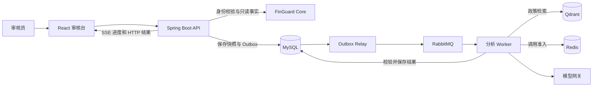

# FinGuard Copilot

**面向风控审核员的证据核查与风险建议工具。** 从交易事实到政策引用，再到人工复核，审核员可以沿着证据核对每一条建议。

[项目介绍](#项目介绍) · [系统架构](#系统架构) · [技术栈](#技术栈) · [功能特性](#功能特性) · [效果展示](#效果展示) · [项目结构](#项目结构) · [快速开始](#快速开始) · [Docker 快速部署](#docker-快速部署) · [使用场景](#使用场景) · [常见问题](#常见问题) · [TODO](#todo)

## 项目介绍

审核员处理大额交易风险时，需要核对交易金额、历史命中阈值、对账结果和适用政策。FinGuard Copilot 接收审核任务编号，从 Core 读取授权范围内的业务事实，检索已发布的政策，并返回附有来源与引用的结构化建议。最终审核决定由审核员在 FinGuard Core 提交。 [FinGuard Core](https://github.com/jkwang1129/finguard-core)

## 系统架构



创建分析时，事实快照、运行记录和 Outbox 事件在同一 MySQL 事务中写入。Worker 处理 RabbitMQ 事件，完成检索、模型调用和结果校验，再将状态与结果保存。审核台通过 SSE 读取进度，并可在断线后按游标继续。 [详细时序与代码入口](docs/ARCHITECTURE.md)

## 技术栈

| 层 | 技术 | 在项目中的用途 |
| --- | --- | --- |
| 后端 | Java 17、Spring Boot 4、Spring AI Alibaba Graph | 审核 API、异步分析、Agent 工作流与人工继续 |
| 数据与消息 | MySQL、Flyway、RabbitMQ、Redis | 数据迁移、事实快照、Outbox、运行检查点、模型配额与并发控制 |
| 知识与模型 | Qdrant、JSON Schema | 已发布政策索引的检索、政策引用和结构化输出校验 |
| 前端 | React、TypeScript、Vite、SSE | 审核结果、进度续读和反馈操作 |
| 评测与观测 | Python、LangGraph、OpenTelemetry、Micrometer | 离线回归、参考流程、运行追踪与指标 |
| 构建与交付 | Docker Compose、GitHub Actions | 隔离环境、测试、按提交 SHA 构建和扫描镜像 |

## 功能特性

- **事实与政策可追溯。** 展示交易金额、来源字段和政策版本。服务端校验 JSON Schema、业务事实值和引用。关键证据不足时，页面显示待补信息。
- **异步分析可恢复。** 事务 Outbox 保证任务受理后有可重投的记录，幂等键与 Worker 回执处理重复请求和消息。SSE 持久化状态支持断线续读。
- **Agent 可人工继续。** 可选的 Agent 路径使用只读工具白名单与 MySQL 检查点。人工确认后按运行修订号继续，STDIO MCP 桥复用同一批工具。
- **模型调用有预算。** 发送前冻结配置与价格并预留费用，Redis 管理并发许可和配额，调用后按用量结算。
- **审核反馈可回归。** 页面记录同意、不同意或暂无法判断。审核人可独立标注、筛选并脱敏案例，冻结为可重复运行的回归集。

## 效果展示

下图是本地合成大额风险案例的审核结果。页面依次展示分析进度、建议、业务证据、政策引用和反馈入口。本次截图使用本地模型替身。


## 项目结构

```text
finguard-copilot/
├── src/main/                 # Java 服务、模型输出 Schema 与数据库迁移
├── src/test/                 # 单元测试与集成测试
├── frontend/                 # React 审核台
├── tools/
│   ├── agent-evaluation/     # Python 离线评测与回归数据
│   ├── mcp-bridge/           # STDIO MCP 桥
│   └── semantic-embedding/   # 可选的本地语义向量服务
├── ops/                      # Compose 与可观测性配置
├── scripts/                  # 启动、测试、发布与故障演练入口
└── docs/                     # 架构、运行、部署和验证说明
```

## 快速开始

准备 Git、Python 3.11.5+、Docker（Linux 容器模式）和 Docker Compose。首次启动会从镜像仓库、Maven Central 和 npm 获取构建依赖。将两个仓库克隆为同级目录。

```sh
git clone https://github.com/jkwang1129/finguard-core.git
git clone https://github.com/jkwang1129/finguard-copilot.git
cd finguard-copilot
```

进入 Copilot 目录后，按下方 Docker 命令启动。演示使用合成交易、合成政策和本地模型替身，无需 API Key。 [开发与测试手册](docs/RUNBOOK.md)

## Docker 快速部署

### Windows PowerShell

```powershell
python scripts/run-integration.py --core-root ../finguard-core --core-ref (Get-Content ops/integration/core-revision.txt).Trim() --keep
```

### Linux / macOS

```sh
python3 scripts/run-integration.py --core-root ../finguard-core \
  --core-ref "$(cat ops/integration/core-revision.txt)" --keep
```

脚本用 Docker Compose 启动隔离环境，导入案例、执行端到端检查，并打印验收目录与清理命令。`--keep` 保留服务供浏览器演示。

| 服务 | 默认地址 |
| --- | --- |
| Copilot 审核台 | [127.0.0.1:15173](http://127.0.0.1:15173/) |
| Core 业务控制台 | [127.0.0.1:18080/demo/index.html](http://127.0.0.1:18080/demo/index.html) |

1. 用 `e2e-reviewer` 登录审核台。密码取终端提示的本次 `.env` 中的 `FG_REVIEWER_PASSWORD`。
2. 打开同目录下的 `report.json`，将 `analysisId` 填入「恢复已有分析」，查看已生成的建议和证据。
3. 演示结束后运行终端打印的 Compose 清理命令。

用完整 SHA 制品部署到 Linux、切换版本或演练恢复时，参照独立手册。 [镜像发布、部署与回滚](docs/DEPLOYMENT.md)

## 使用场景

| 场景 | 操作 |
| --- | --- |
| 大额交易复核 | 对照交易金额、命中时的历史阈值和政策引用，确认风险项是否应保留供跟进 |
| 证据不足的任务 | 查看缺失事实或政策引用，补齐资料后再形成审核判断 |
| 审核反馈复盘 | 将人工判断与建议对照，筛选典型案例并离线复跑 |
| 故障恢复演练 | 在隔离环境复验 MySQL 备份恢复、RabbitMQ 重投、Qdrant 重建和版本回滚 |

## 常见问题

**演示需要申请模型密钥吗？** 隔离演示使用本地模型替身。供应商调用用于独立模型评测。

**端口占用或启动失败怎么查？** 使用 `--web-port` 或 `--core-port` 指定空闲端口。启动失败时查看终端输出和验收目录的 `failure.log`。修改 Core 端口后，可直接访问该端口下的 `/demo/index.html`。

**页面登录失败或找不到分析怎么办？** 使用同一批次 `.env` 中的密码和 `report.json` 中的 `analysisId`。重新启动会生成新的验收批次。

**反馈会修改 Core 的审核结果吗？** 反馈保存到 Copilot，记录审核员对建议的评价。业务审核决定在 Core 单独提交。

**如何运行测试？** Windows 运行 `.\scripts\verify.ps1`，Linux 或 macOS 运行 `bash scripts/verify.sh`。 [工程测试](docs/RUNBOOK.md#工程测试) · [验收结果](docs/VERIFICATION.md)

## TODO

- [ ] 增加阈值边界、政策缺失等可直接在页面体验的演示案例。
- [ ] 扩充多文档检索和政策冲突的回归样本。
- [ ] 增加对真实模型建议的人工复核样本，并记录分歧理由。
