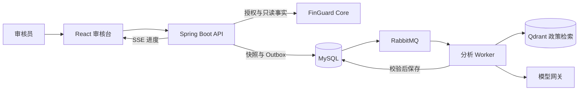

# FinGuard Copilot

**面向风控审核员的证据核查与风险建议工具。** 审核员打开一条风险任务，Copilot 汇总交易、对账和风险命中事实，检索适用政策，给出附带证据与引用的审核建议。最终审核决定由审核员在 [FinGuard Core](https://github.com/jkwang1129/finguard-core) 提交。

## 能做什么

| 审核场景 | 页面提供的能力 |
| --- | --- |
| 核查大额交易风险 | 按 Core 记录的交易金额和历史阈值核查命中依据，保留十进制精度与来源字段 |
| 查找适用政策 | 检索已发布的知识库，展示政策版本和引用。关键证据不足时给出明确提示 |
| 跟踪分析与人工复核 | 通过 SSE 查看进度并断线续读。Agent 路径支持持久化暂停和人工继续 |
| 沉淀审核反馈 | 审核员可记录同意、不同意或暂无法判断。经独立标注和脱敏后，可纳入离线回归集 |

<details>
<summary>查看审核台截图</summary>


截图使用合成案例和本地模型替身。

</details>

## 技术亮点

- **可靠的异步处理。** 一次 MySQL 事务保存事实快照、分析运行和 Outbox 事件。RabbitMQ 驱动 Worker，幂等键与消费回执处理重复请求和消息重投。
- **可追溯的 RAG 与结构化输出。** Qdrant 检索已发布索引，MySQL 保留知识正文与版本。服务端在展示前校验 JSON Schema、业务事实值和政策引用。
- **可恢复的 Agent 与费用治理。** Agent 使用只读工具白名单和 MySQL 检查点。Redis 控制并发与配额，模型调用前冻结配置并预留费用，调用后按用量结算。
- **可复跑的部署验证。** Docker Compose 启动隔离环境。GitHub Actions 按完整提交 SHA 构建和扫描镜像，已演练版本回滚、MySQL 恢复、RabbitMQ 停机重投和 Qdrant 重建。

## 架构



**技术栈**　Java 17、Spring Boot、Spring AI Alibaba Graph、MySQL、RabbitMQ、Redis、Qdrant、React、TypeScript、Docker Compose。Python 与 LangGraph 用于离线评测和参考实现。

## 本地运行

准备 Git、Python 3.11.5+、Docker（Linux 容器）和 Docker Compose。将两个仓库克隆到同一目录，再进入 Copilot 仓库。

```sh
git clone https://github.com/jkwang1129/finguard-core.git
git clone https://github.com/jkwang1129/finguard-copilot.git
cd finguard-copilot
```

### Windows PowerShell

```powershell
python scripts/run-integration.py --core-root ../finguard-core --core-ref (Get-Content ops/integration/core-revision.txt).Trim() --keep
```

### Linux / macOS

```sh
python3 scripts/run-integration.py --core-root ../finguard-core \
  --core-ref "$(cat ops/integration/core-revision.txt)" --keep
```

脚本从空卷构建并启动环境、导入一条合成审核案例，然后执行端到端检查。使用本地模型替身，无需 API Key。通过后打开 [本地审核台](http://127.0.0.1:15173/)，使用 `e2e-reviewer` 和终端提示的本次 `.env` 密码登录。在「恢复已有分析」填入验收报告中的 `analysisId`，即可查看建议、证据和引用。清理时运行脚本在终端打印的 Compose 命令。

## 进一步了解

- [架构与关键设计](docs/ARCHITECTURE.md)
- [运行、测试与故障排查](docs/RUNBOOK.md)
- [发布、回滚与恢复](docs/DEPLOYMENT.md)
- [验证结果与证据链接](docs/VERIFICATION.md)
