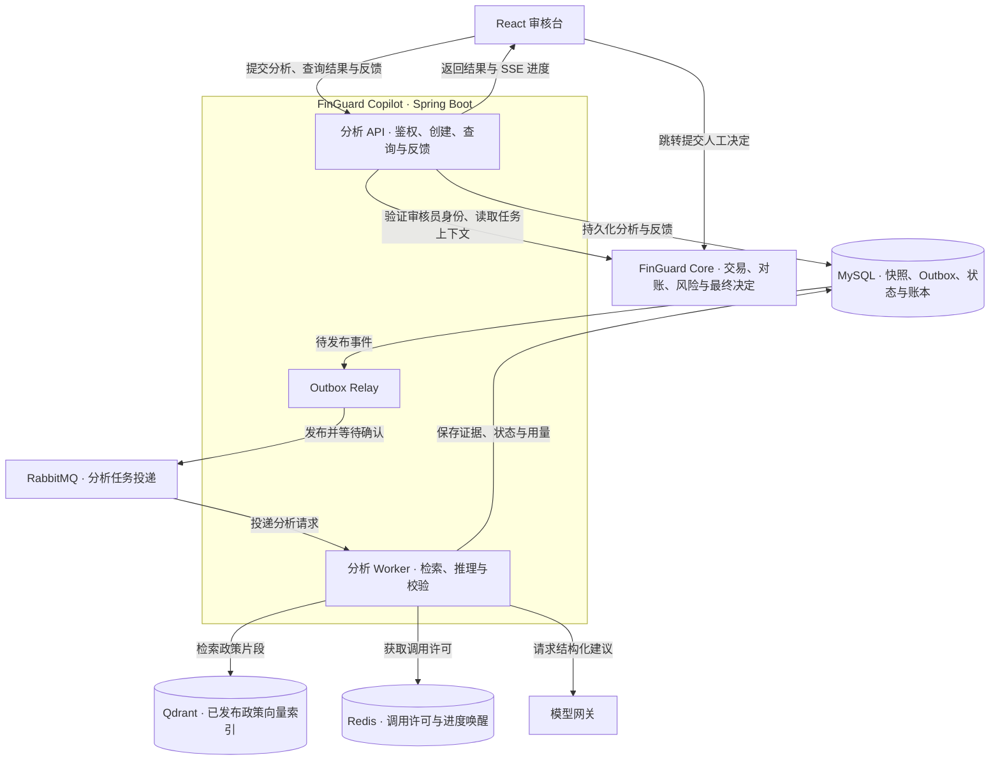
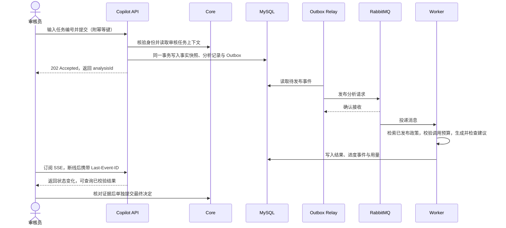
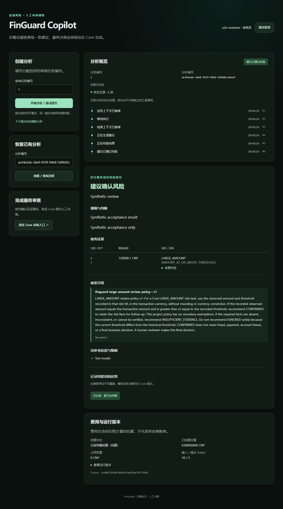
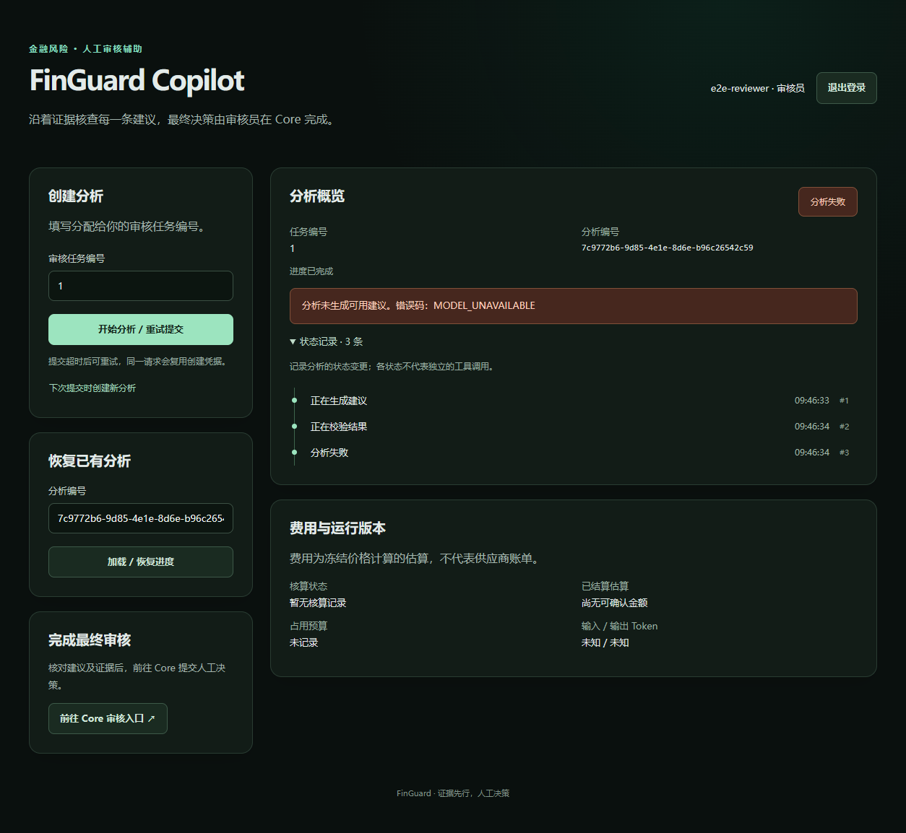

# FinGuard Copilot

**把一条风控告警变成审核员可以逐项核对的证据和建议。**

FinGuard Copilot 是一个 Java 风控审核辅助项目。审核员输入任务编号，系统读取交易与风险命中记录，查找适用政策，生成附有证据和引用的审核建议。审核员在 Copilot 核对和反馈，在 [FinGuard Core](https://github.com/jkwang1129/finguard-core) 完成最终决定。

[查看审核台截图](#效果展示) · [启动本地演示](#快速开始) · [了解系统架构](#系统架构) · [查看验证结果](docs/VERIFICATION.md)

| 想了解什么 | 从这里开始 |
| --- | --- |
| 产品做什么 | [项目介绍](#项目介绍) · [功能特性](#功能特性) · [使用场景](#使用场景) |
| 工程怎么实现 | [系统架构](#系统架构) · [技术栈](#技术栈) · [项目结构](#项目结构) |
| 怎样运行和体验 | [效果展示](#效果展示) · [快速开始](#快速开始) · [Docker 快速部署](#docker-快速部署) · [常见问题](#常见问题) |
| 后续可以做什么 | [TODO](#todo) |

## 项目介绍

风控系统生成一条告警后，审核员还要回答三个问题：**当时命中了什么规则？支撑它的业务记录在哪里？依据哪条政策作出判断？** 例如，大额风险复核需要使用命中时记录的阈值。直接拿今天的阈值比较，会改变对历史告警的解释。

### 一个大额交易案例

| 审核环节 | 演示中的数据与结果 |
| --- | --- |
| 查业务记录 | 合成支出交易为 **120,000.10 CNY**。Core 保存的命中观察金额也是 **120,000.10 CNY**，当时的阈值为 **100,000.00 CNY**。 |
| 查适用政策 | 项目演示政策要求观察金额与交易金额一致，且大于或等于同币种历史阈值。缺少关键金额、事实矛盾或无法核实时，应提示证据不足。 |
| 给出审核建议 | 页面显示「建议确认风险」，即建议保留该风险项供后续核查，并附上业务字段及政策版本。 |
| 留下人工结论 | 审核员可在 Copilot 记录对建议的反馈，在 Core 单独提交最终业务决定。 |

示例使用项目自定义政策及合成数据。「建议确认风险」表示应保留风险项供进一步核查。 [查看演示政策原文](src/main/resources/knowledge/large-amount-review-policy-v1.txt)

## 系统架构

### 服务与数据边界



Core 持有原始业务数据。Copilot 使用审核员身份访问白名单只读接口，把分析所需的最小快照保存在自己的库。Worker 可以据此复现本次分析所用的事实。两套服务使用独立数据库账户。

### 一次分析如何执行



| 工程问题 | 实现方式 |
| --- | --- |
| 任务已受理，消息暂时发不出去 | 分析记录和 Outbox 同事务提交。RabbitMQ 恢复后 Relay 可继续投递。`202` 表示已受理，处理结果按分析编号查询。 |
| 用户重复提交，或同一消息再次投递 | 创建接口用幂等键识别重放，Worker 使用持久回执识别消息重投。模型调用另有持久占用，发送状态不确定时避免盲目重发。 |
| 浏览器刷新或网络断开 | 状态事件保存在 MySQL，SSE 通过 `Last-Event-ID` 补读。Redis 可唤醒进度读取，唤醒不可用时可回落至数据库轮询。 |
| 索引和模型返回的内容需要核验 | 业务金额以 Core 快照为准。知识库检索返回已发布版本的片段，服务端校验金额、证据来源、政策引用与结构化输出。 |

[架构设计与源码入口](docs/ARCHITECTURE.md)

## 技术栈

下表版本取自仓库的构建配置和隔离演示镜像。

| 技术 | 版本 | 在项目中的职责 |
| --- | --- | --- |
| Java / Spring Boot | 17 / 4.0.9 | Web MVC 接口、业务校验、事务和 Worker |
| Spring AI / Spring AI Alibaba Graph | 1.1.6 / 1.1.2.2 | 接入模型及可选 Agent 工作流编排 |
| MySQL / Flyway | 8.4.10 / Maven 管理 | 数据库迁移，保存事实快照、分析状态、反馈、检查点和费用账本 |
| RabbitMQ | 4.3.4 | 接收 Outbox 投递的任务，将分析交给 Worker |
| Redis | 8.2.8 | 调用并发许可、审核员限流和进度唤醒 |
| Qdrant | 1.15.5 | 以已发布索引检索相关政策片段 |
| React / TypeScript / Vite | 19.2 / 6.0 / 8.2 | 审核台、证据展示、进度续读和人工反馈 |
| Python / LangGraph | 3.12 / uv 锁定 | 离线评测、数据集回归与参考工作流 |
| OpenTelemetry / Micrometer | Maven 管理 | 串联 API、消息投递、Worker 和模型调用，输出链路和指标 |
| Testcontainers / Docker Compose / GitHub Actions | 仓库配置 | 中间件集成测试、隔离部署、镜像构建与扫描 |

[后端依赖](pom.xml) · [前端依赖](frontend/package.json) · [Compose 配置](ops/integration/compose.yml)

## 功能特性

### 1. 可核对的业务证据与政策引用

- 从 Core 获取交易、对账、风险规则与命中时的阈值。大额场景保留十进制金额和原始来源字段。
- 政策文档清洗和分段后构建候选索引，通过检索评测才发布。结果附上政策版本和命中的片段。
- 模型返回后校验 JSON Schema、金额、证据及引用。证据缺失与运行失败分别展示，审核员可以看到缺什么，或是哪一步未完成。

### 2. 异步审核与可恢复的 Agent

- 审核台显示排队、检索、生成、校验等进度，可以凭分析编号重新打开。
- 可选 Agent 路径用固定 Schema 调用白名单只读工具，把检查点写入 MySQL。需要人工确认时暂停，收到带运行修订号的操作后再继续。
- Agent Trace 用于查看工作流步骤。授权后的 STDIO MCP 桥复用同一组只读工具。 [Agent 源码](src/main/java/com/finguard/copilot/agent) · [MCP 桥](tools/mcp-bridge)

### 3. 模型调用与成本治理

- 调用前冻结模型配置和计价，检查配额与并发许可，并在 MySQL 预留费用。调用后根据已报告的 Token 用量结算估算值。
- 审核页可查看费用状态、Token 用量、运行版本与 Trace。审核 Worker 可通过运维开关在调用前切换到已评测的备用模型。
- 模型不可用时保留失败状态和诊断信息，审核员仍可进入 Core 完成人工审核。

### 4. 人工反馈与离线回归

- 审核员对建议选择「同意建议」「不同意建议」或「暂无法判断」。反馈保存在 Copilot，提交后不可覆盖。
- 反馈可与独立人工标签配对，经筛选、脱敏后冻结为评测样本，复跑建议、引用与拒答等检查。 [反馈回归流程](tools/agent-evaluation/README.md#审核反馈回归)

## 效果展示

### 大额风险审核台

左侧可创建分析、恢复已有结果或跳转到 Core。右侧按顺序展示状态记录、审核建议、业务证据、政策引用、人工反馈和费用版本。下图来自使用本地模型替身的合成演示。



### 模型不可用时

在受控失败演示中，审核台显示 `MODEL_UNAVAILABLE`、状态记录和费用核算状态。页面保留 Core 审核入口，便于继续人工处理。

<details>
<summary>查看模型不可用时的审核台截图</summary>



</details>

### 验证范围

| 已验证场景 | 结果 |
| --- | --- |
| 本地 Compose 端到端流程 | 从空卷启动并通过 **36 项**检查，覆盖登录、请求重放、Worker、政策引用、SSE 和 Core 数据校验。 |
| 故障与数据恢复 | **46 项**恢复批次检查，覆盖 MySQL 恢复、RabbitMQ 停机重投和 Qdrant 空卷重建。 |
| 模型与人工反馈 | 两个模型分别通过固定合成集的 **12/12** 条建议检查与 **5/5** 条应拒答检查。另用一条合成案例验证真人提交反馈与离线复跑。 |

[完整验证结果、运行范围与制品](docs/VERIFICATION.md)

## 项目结构

```text
finguard-copilot/
├── src/main/java/com/finguard/copilot/
│   ├── api/          # 创建、查询、SSE、反馈与人工继续接口
│   ├── coreclient/   # Core 身份与只读业务接口适配
│   ├── analysis/     # 分析编排与结果查询
│   ├── dispatch/     # Outbox Relay、消息拓扑和 Worker
│   ├── events/       # 进度事件存储与 SSE 续读
│   ├── knowledge/    # 政策入库、索引发布、检索与引用
│   ├── guardrail/    # 金额、政策、引用与输出校验
│   ├── governance/   # 模型路由、调用准入、配置与价格冻结
│   └── agent/        # 图工作流、只读工具、检查点与人工继续
├── src/main/resources/   # Flyway 迁移、提示词和 JSON Schema
├── src/test/             # Java 单元与中间件集成测试
├── frontend/             # React 审核台
├── tools/
│   ├── agent-evaluation/ # Python 评测、参考工作流和冻结样本
│   ├── mcp-bridge/       # 本地 STDIO MCP 桥
│   └── semantic-embedding/ # 可选的本地语义向量服务
├── ops/                  # Compose 和可观测性配置
├── scripts/              # 启动、测试、制品与恢复脚本
└── docs/                 # 架构、运行、发布与验证说明
```

追踪一条分析请求可以从 [创建接口](src/main/java/com/finguard/copilot/api/analysis/ReviewAnalysisController.java) 开始，再看 [创建服务](src/main/java/com/finguard/copilot/analysis/application/CreateAnalysisService.java)、[Worker](src/main/java/com/finguard/copilot/dispatch/AnalysisWorker.java) 和 [审核台](frontend/src/App.tsx)。

## 快速开始

### 1. 检查环境

准备 Git、Python **3.11.5+**、Docker 和 Compose 插件。Docker Desktop 使用 Linux 容器模式，Compose 需支持 `up --wait`。首次构建会下载基础镜像和 Maven、npm 依赖；演示不需要本机安装 JDK、Node.js 或配置模型 API Key。

```sh
git --version
docker compose version
docker info --format '{{.OSType}}'
```

Windows 用 `python --version`，Linux / macOS 用 `python3 --version` 检查 Python。Docker 类型应显示 `linux`。

### 2. 克隆两个仓库

将两份源码放在同级目录。启动脚本会按 Copilot 仓库记录的 Core 提交构建，常规完整克隆即可。

```sh
git clone https://github.com/jkwang1129/finguard-core.git
git clone https://github.com/jkwang1129/finguard-copilot.git
cd finguard-copilot
```

### 3. 启动后体验一笔审核

先执行下方 [Docker 启动命令](#docker-快速部署)，等待终端输出 `Acceptance report`，然后按顺序操作：

1. 打开 [Copilot 审核台](http://127.0.0.1:15173/)，用户名填 `e2e-reviewer`。在终端提示的本次 `.env` 文件中找到 `FG_REVIEWER_PASSWORD`，复制等号右侧引号内的密码。
2. 打开同目录下的 `report.json`。`passed` 为 `true` 表示检查通过。复制 `analysisId`，粘贴到「恢复已有分析」，点「加载 / 恢复进度」。
3. 展开「状态记录」，查看从排队到校验成功的过程。在「业务证据」核对金额和来源，在「政策引用」核对政策版本与文本。展开「查看运行版本」可看本次运行信息。
4. 在「记录对建议的反馈」点击一个选项，页面显示「已记录」。想亲自发起分析，可把「分析概览」里的任务编号填回「创建分析」，再点「开始分析 / 重试提交」。
5. 如需体验最终人工决定，点「前往 Core 审核入口」，或打开 [Core 业务控制台](http://127.0.0.1:18080/demo/index.html)，用同一审核员账号查看业务任务。

## Docker 快速部署

### 本地演示

在 Copilot 仓库根目录按系统选择一条命令。

**Windows PowerShell**

```powershell
$coreRef = (Get-Content ops/integration/core-revision.txt).Trim()
python scripts/run-integration.py --core-root ../finguard-core --core-ref $coreRef --keep
```

**Linux / macOS**

```sh
python3 scripts/run-integration.py --core-root ../finguard-core \
  --core-ref "$(cat ops/integration/core-revision.txt)" --keep
```

启动脚本会构建 Core、Copilot 和前端镜像，拉起 MySQL、RabbitMQ、Redis、Qdrant 与本地 HTTP 模型替身。随后生成临时账号、发布演示政策、写入一条合成风险任务并自动完成一次分析。

| 入口 | 默认值或用途 |
| --- | --- |
| Copilot 审核台 | `http://127.0.0.1:15173/`，可用 `--web-port` 更换端口 |
| Core 业务控制台 | `http://127.0.0.1:18080/demo/index.html`，可用 `--core-port` 更换端口 |
| 本次临时凭据 | `target/integration/<项目名>/.env` |
| 本次检查结果 | 同目录的 `report.json`，包含 `analysisId`、终态及各项检查 |
| 中间件与管理端点 | 保留在容器网络内 |

`--keep` 会在成功后保留容器和演示数据。体验结束后执行终端打印的 `Cleanup` 命令，清理该批次的容器、网络和数据卷。只想自动跑一轮验证时，去掉 `--keep`，脚本会在结束后自动清理。

### 在 Linux 上部署发布制品

CI 按完整 Git SHA 构建镜像，制品包含镜像归档、清单和验收结果。部署脚本会校验归档与镜像身份，使用指定版本启动并等待健康检查。升级和回滚沿用同一环境文件与数据卷，并检查两套数据库的迁移指纹。 [制品构建、部署命令、回滚与恢复](docs/DEPLOYMENT.md)

## 使用场景

| 场景 | 怎样使用 | 审核员看到什么 |
| --- | --- | --- |
| 复核大额交易 | 输入 Core 审核任务编号，对照交易金额、命中时的观察金额和阈值 | 建议、来源字段和适用政策，可逐项核对 |
| 资料缺失或金额矛盾 | 查看待补项或校验失败提示，核对 Core 原始记录 | 证据不足说明，或被校验拒绝的状态 |
| 分析中断后继续 | 刷新或重新登录，用分析编号加载已有进度 | 已保存的状态和终态结果，可继续原审核 |
| 复盘建议质量 | 先独立判断，再提交反馈并挑选典型案例 | 审核员与系统的判断差异，可经脱敏用于回归 |

## 常见问题

### 需要申请 API Key 或付费吗？

本地演示调用容器内的模型替身，交易和政策都是合成数据，费用账本仍会展示本次运行记录。真实供应商评测有独立入口。 [离线评测工具](tools/agent-evaluation/README.md)

### Docker 启动失败或端口占用怎么办？

确认 Docker 已启动且处于 Linux 容器模式。构建失败时先看终端中的镜像或依赖下载错误，服务启动失败时查看本次批次的 `failure.log`（若已生成）。端口占用时可在启动命令末尾追加 `--web-port 15174 --core-port 18081`。更换 Core 端口后，直接访问新端口的 `/demo/index.html`，页面上的 Core 跳转链接由镜像构建配置决定。

### 登录失败，或能登录但找不到分析？

使用同一次启动生成的 `.env` 和 `report.json`。每次启动都会生成新的密码和分析编号。「恢复已有分析」填 `analysisId`；「创建分析」填 Core 的审核任务编号。

### 提交反馈会改变 Core 审核状态吗？

反馈记录对当前建议的评价，保存到 Copilot。Core 的审核状态由审核员在业务控制台单独更新。

### 怎样单独开发或运行测试？

前端在 `frontend/` 下运行 `npm ci` 和 `npm run dev`，Vite 代理需要已启动的 Core 与 Copilot。全量工程测试需要 JDK 17、Docker、Node.js 24 和 uv，Windows 运行 `.\scripts\verify.ps1`，Linux / macOS 运行 `bash scripts/verify.sh`。 [前端开发](frontend/README.md) · [工程测试](docs/RUNBOOK.md#工程测试)

## TODO

- [ ] 提供可直接从演示页面打开的阈值相等、政策缺失和事实冲突案例。
- [ ] 扩充多文档检索与政策版本冲突的回归样本。
- [ ] 扩充真实模型输出的独立人工标注，记录分歧理由和证据依据。
