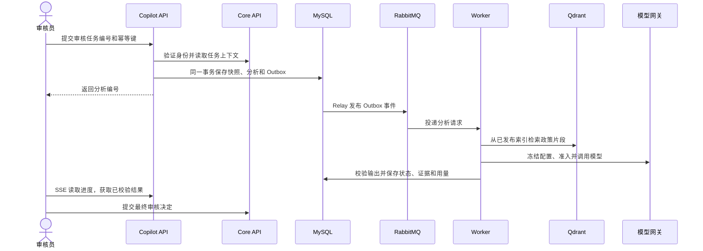

# 架构与关键设计

FinGuard Core 持有交易、对账、风险命中和最终审核决定。Copilot 使用 Core 审核员的身份访问白名单只读接口，保存分析所需的最小事实快照。两套服务使用独立数据库账户。Copilot 生成的建议、进度和反馈存储在自己的 MySQL 库中。

## 一次分析如何完成

- **事务与幂等。** 幂等键绑定创建请求，Worker 使用持久回执处理消息重投。模型调用另有持久占用记录，发送结果不确定时保留占用，避免盲目重发。
- **RAG 发布。** 文档清洗、分段并计算校验和后进入候选索引，候选通过评测后才能发布。检索返回版本和片段标识，正文以 MySQL 中的记录为准。结构化结果须引用实际提供的事实与政策证据。
- **Agent 续跑。** 可显式启用的 Agent 工作流保存 MySQL 检查点，使用固定工具 Schema、只读执行权限与调用预算。人工确认后按运行修订号继续。STDIO MCP 桥以短期授权复用同一批工具。
- **费用与进度。** Redis 负责调用准入的并发许可与审核员限流。MySQL 保存预算、冻结价格和账本，也保存可按游标恢复的 SSE 状态。Redis 唤醒可选，进度读取可回落至数据库轮询。
- **可观测性。** OpenTelemetry 输出受控 Trace，Micrometer 提供指标。可选 Langfuse、Prometheus 与 Grafana 用于本地诊断和故障演练。

## 从哪里读代码

| 关注点 | 代码入口 |
| --- | --- |
| 审核 HTTP 接口和 SSE | [API](../src/main/java/com/finguard/copilot/api/analysis) · [事件流](../src/main/java/com/finguard/copilot/events) |
| Core 只读适配、快照与异步投递 | [Core 客户端](../src/main/java/com/finguard/copilot/coreclient) · [上下文](../src/main/java/com/finguard/copilot/context) · [Outbox 与 Worker](../src/main/java/com/finguard/copilot/dispatch) |
| 知识检索、模型治理与结果校验 | [知识库](../src/main/java/com/finguard/copilot/knowledge) · [模型治理](../src/main/java/com/finguard/copilot/governance) · [护栏](../src/main/java/com/finguard/copilot/guardrail) |
| 工具、检查点、人工继续和 MCP | [Agent](../src/main/java/com/finguard/copilot/agent) · [STDIO 桥](../tools/mcp-bridge) |
| 审核页面与离线评测 | [React 前端](../frontend) · [Python 评测工具](../tools/agent-evaluation) |

[本地运行与测试](RUNBOOK.md) · [验证范围与结果](VERIFICATION.md)
