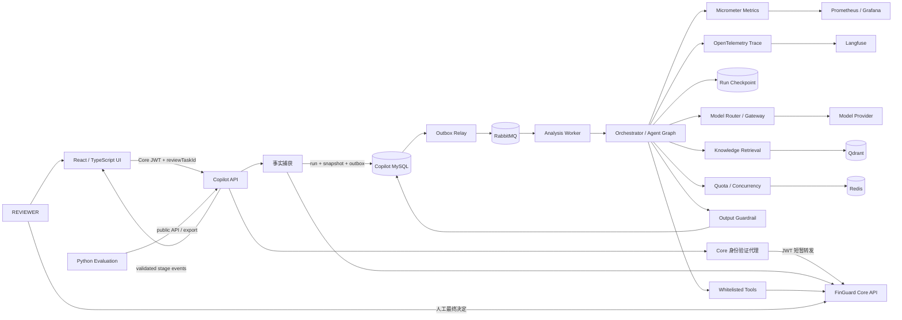
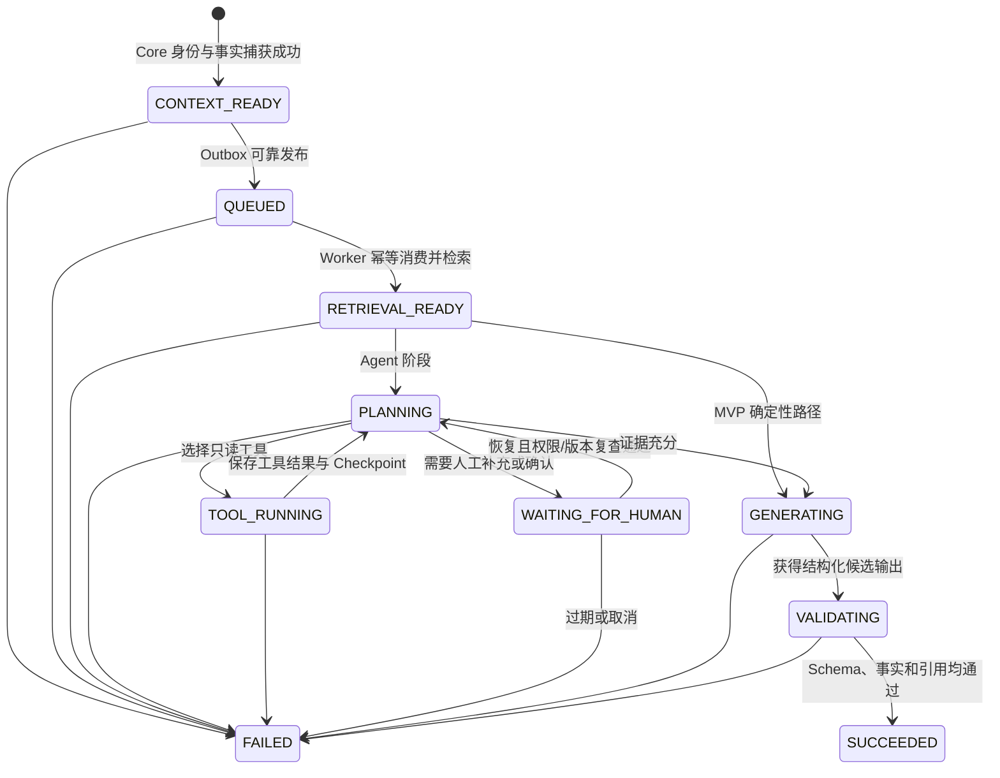
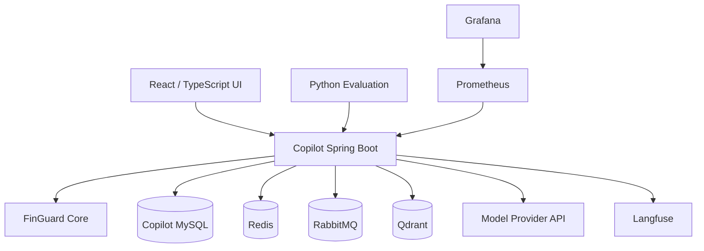

# FinGuard Copilot 系统架构

本文同时描述目标架构；当前已实现范围以[TASKS](../TASKS.md)及验收记录为准。P4-3 的实际清单、预算、Redis许可及单主模型边界见[运行说明](operations/phase4-3-governance.md)和[验收记录](acceptance/2026-11-02-p4-3-governance.md)。P4-4 已接入显式、脱敏的 Copilot 阶段 Trace、Langfuse、Prometheus/Grafana 与预算状态指标，范围见[运行说明](operations/phase4-4-observability.md)。P4-5 的事务状态事件、授权 SSE 和 React 审核台见[运行说明](operations/phase4-5-review-console.md)。Core/供应商内部 Span、Graph 和模型工具执行仍属于独立范围。

## 1. 架构目标

本架构将确定性业务系统与概率性模型隔离。任何可能改变 FinGuard 业务状态的操作仍由
Core 执行并受其 RBAC、乐观锁和审计控制；Copilot 只生成可校验的审核辅助材料。

## 2. 系统上下文



## 3. 服务内部边界

建议保持一个 Spring Boot 模块化单体，通过 Java 包和端口接口隔离职责：

| 模块 | 职责 | 允许依赖 |
|---|---|---|
| `api` | HTTP、DTO、认证入口、错误映射 | `analysis`、`feedback` |
| `coreclient` | Core 白名单 API、超时、契约映射 | HTTP 客户端 |
| `analysis` | 分析状态机、幂等、编排 | 领域端口 |
| `context` | 最小事实快照、来源、预算和去重 | `coreclient` |
| `agent` | Tool、Graph、运行级状态、HITL 和回放 | 领域端口 |
| `knowledge` | 数据摄取、版本发布、检索和引用 | 向量存储端口 |
| `model` | 模型路由、请求、结构化响应、用量和成本 | 模型客户端端口 |
| `dispatch` | Outbox、RabbitMQ、幂等消费和重试 | 消息与存储端口 |
| `quota` | 用户配额、供应商并发和限流 | Redis 端口 |
| `events` | 持久状态事件、有界授权 SSE 和可选 Redis 唤醒 | `analysis` 授权及持久端口 |
| `guardrail` | Schema、事实、引用和安全校验 | 纯领域对象 |
| `runstore` | 运行、快照、证据、引用、版本 | MySQL 端口 |
| `evaluation` | 评测导出、Golden Dataset 和 Judge 接口 | 上述公开端口 |
| `observability` | 指标、Agent Trace、审计事件 | Micrometer/OpenTelemetry |

模块通过领域接口交互，具体模型、向量库和 HTTP 客户端均放在适配器层。模型供应商和
向量存储可以替换，但领域输出契约不随其变化。

## 4. Core 契约

Copilot 需要 Core 增加两个通用、非 AI 专属的只读接口：

```text
GET /api/auth/me
GET /api/review-tasks/{reviewTaskId}/context
```

`/api/auth/me` 返回当前用户标识和角色。Copilot 要求角色包含 `REVIEWER`；它不保存返回的
JWT，也不持有 Core 签名密钥。

`context` 以审核任务版本为一致性边界，返回以下逻辑结构：

```json
{
  "reviewTask": {
    "id": 1001,
    "version": 3,
    "status": "PENDING",
    "ruleCode": "HIGH_AMOUNT",
    "reasonCode": "AMOUNT_THRESHOLD_EXCEEDED",
    "createdAt": "2026-08-20T08:00:00Z"
  },
  "transaction": {
    "id": 2001,
    "accountId": 3001,
    "amount": "120000.00",
    "currency": "CNY",
    "occurredAt": "2026-08-20T07:55:00Z",
    "sourceType": "MANUAL"
  },
  "reconciliation": {
    "resultType": "SUSPICIOUS",
    "matchMethod": "AMOUNT_AND_TIME",
    "reasonCode": "DUPLICATE_CANDIDATE"
  },
  "riskFacts": [
    {"code": "AMOUNT", "value": "120000.00", "source": "transaction.amount"}
  ],
  "accountSummary": {
    "status": "ACTIVE",
    "displayName": "王**"
  },
  "capturedAt": "2026-08-20T08:01:00Z"
}
```

正式实现时 DTO 字段以 Core 领域可证明的事实为准，但必须满足：固定 Schema、金额使用
十进制字符串、时间带时区、敏感字段脱敏、每个风险事实包含来源路径、响应包含审核任务
版本。接口和 DTO 名称不得包含 `AI`、`LLM` 或 Prompt。

## 5. 分析状态机与数据流



`INSUFFICIENT_EVIDENCE` 是成功结果中的 `recommendation`，不是运行状态。基础设施故障、
Schema 失败或安全校验失败使用 `FAILED`，并保存低敏感度 `failureCode`，不保存异常密钥或
完整上游响应。

创建流程中，API 必须在返回 `202` 前完成身份确认和上下文捕获，并在同一数据库事务中
写入 `CONTEXT_READY` 运行、事实快照和 Outbox 事件。这保证后台任务不需要保存 JWT，也
不会出现“API 已接受但任务未入队”的窗口。Outbox Relay 至少一次投递到 RabbitMQ，Worker
以 `analysisId + stage + attempt` 幂等消费。Core 身份或上下文调用失败时不创建分析运行；
后台工作只读取不可变的脱敏快照。

MVP 走 `RETRIEVAL_READY -> GENERATING` 的确定性路径。阶段 5 才启用 Tool、Graph、
Checkpoint 和 HITL 分支。暂停恢复时重新验证当前用户权限、运行归属、等待状态和过期时间；
模型输出不能构造有效恢复凭证。

## 6. 上下文策略

MVP 不保留长期聊天历史，每次分析只围绕一个审核任务构建上下文。默认最大输入预算为
32,000 Token，分配如下：

| 内容 | 最大预算 |
|---|---:|
| 系统指令、输出 Schema 和安全策略 | 4,000 |
| Core 业务事实 | 8,000 |
| RAG 文档片段与引用元数据 | 12,000 |
| 用户补充问题 | 2,000 |
| 去重、格式化和模型差异预留 | 6,000 |

默认最大输出为 2,000 Token。事实预算不可被文档挤占；超过预算时先去重和裁剪低排名
文档，不裁剪关键金额、币种、任务版本、规则码和对账结论。裁剪后仍超限则返回
`CONTEXT_BUDGET_EXCEEDED`，不得静默截断关键事实。

MVP 每次分析最多调用模型一次。Agent 阶段才允许在服务器策略下最多两次模型调用和四次
只读工具调用；预算耗尽立即停止。

Agent 的 Working Memory 只在一个 `analysisId` 内存在，包含当前 Graph 节点、已验证事实
引用、已调用工具及结果摘要、剩余预算和等待原因。它通过 Checkpoint 持久化，不保存长期
用户画像或跨任务聊天记忆。工具原始响应只保留完成校验所需的最小脱敏字段。

## 7. RAG 与知识数据管道

允许进入知识库的内容：风险规则说明、审核操作规范、异常处置手册、Core 状态说明、
故障手册和人工编写的脱敏案例。交易金额、审核任务状态等动态事实禁止进入知识库。

```text
登记来源
 -> 解析与清洗
 -> 按标题/语义切分
 -> 添加 documentId/version/section/checksum
 -> 去重
 -> Embedding
 -> 写入候选索引
 -> 固定集评测
 -> 原子发布索引版本
 -> 增量更新或删除
 -> 失败时回滚到上一已发布版本
```

MySQL 保存文档与索引版本元数据，Qdrant 保存向量和检索元数据。运行时只查询一个明确的
已发布索引版本。测试使用内存实现和固定 Embedding，避免网络与浮点漂移。只有评测证明
纯向量召回不足时，才引入 BM25/混合检索和重排；不会先行增加 Elasticsearch。

## 8. 模型与输出契约

领域层只依赖 `ModelGateway`。完整项目默认以 Qwen/DashScope 和 DeepSeek 的
OpenAI-compatible 接口作为两个候选适配器，并由 `ModelRouter` 根据任务类型、质量等级、
上下文长度、剩余预算和供应商健康状态选择。最终模型版本由同一评测集决定。自动降级只能
发生在相同数据分类、地域、安全策略和成本上限内；不得因为主模型失败而向未批准供应商
发送数据，或无预算升级到更强模型。

运行配置包含供应商、模型标识、参数、超时、输入/输出 Token 上限、路由策略和成本表
版本。Redis 只保存短期配额计数、供应商并发租约和健康状态，不缓存动态审核结论或 Core
事实。普通测试使用 `StubModelGateway`；真实模型仅在显式 profile 和密钥存在时运行。

模型输出必须符合固定 JSON Schema，至少包含：

```text
summary
riskRuleExplanation
businessEvidence[]
policyCitations[]
recommendation
reasoningSummary
missingInformation[]
limitations[]
```

服务端逐项验证模型声称的交易 ID、金额、币种、规则码和原因码是否存在于事实快照中，
并验证每个制度结论引用的文档、版本和片段是否来自本次检索结果。任何关键校验失败都不
尝试“猜测修复”为成功结果。

## 9. 持久化

Copilot MySQL 保存：

- `analysis_run`：状态、用户、审核任务、版本、幂等键和时间；
- `analysis_input_snapshot`：最少、脱敏、不可变的 Core 事实及校验和；
- `analysis_checkpoint`：Graph 节点、运行级状态、剩余预算和等待原因；
- `analysis_event`：单调递增序号、受控阶段、状态、错误码和最终结果可用标志；
- `analysis_tool_trace`：工具名、脱敏参数摘要、状态、耗时和结果校验和；
- `analysis_evidence`：被输出引用的事实路径；
- `outbox_event`：异步分析和恢复事件的可靠发布记录；
- `knowledge_document` 与 `knowledge_index_version`：数据管道版本；
- `knowledge_citation`：运行使用的文档、版本、章节和片段；
- `prompt_version` 与 `model_configuration_version`：可复现实验配置；
- `model_usage_ledger`：供应商、模型、Token、估算成本和价格表版本；
- `evaluation_run` 与 `evaluation_result`：数据集、指标、Judge 和人工校准版本；
- `review_feedback`：P4-2 当前只存一次提交的受控 `AGREE` / `DISAGREE` / `UNSURE` 枚举和服务端审核员身份；不收备注。

事实快照默认保留 30 天，评测数据使用专门构造的脱敏案例长期保存。删除事实快照后仍可
保留非敏感运行指标和校验和，但该运行必须标记为不可完整复现。

V8 将快照/结果内容改为带 JSON_VALID 的 LONGTEXT，避免 MySQL 二进制 JSON 对任意精度金额的舍入；模型输出仍为版本一数字契约，Java 解析与响应读取使用 BigDecimal。方向性建议必须由 Core 项目政策、已配置单阈值规则或精确绑定的服务端审定政策包核验；恢复未终态存量结果时也执行该边界。配置与兼容性见[审定政策说明](REVIEWED_POLICIES.md)。

V9增加不可变版本目录与单分析运行清单，V10增加预算账户、预留、分配及追加事件。调用前冻结上下文版本，取得Redis短期许可后，在独立事务中锁分析行并原子取得预算与V6调用占用；调用结果用冻结价格结算。预算未知则保留UNKNOWN_HELD，Redis TTL不释放金额；账单核对通过追加事件表达，旧估算不覆盖。

## 10. 安全控制

- Core 客户端只有编译期白名单路径，模型不能提供 URL。
- MVP 不注册任何写工具。
- Tool 名称、参数、权限、次数、超时和返回 Schema 都由服务器强制校验。
- Prompt 中明确区分系统指令、业务事实、知识片段和用户文本。
- 文档与用户输入中的“忽略规则”“调用工具”等文本只作为数据处理。
- 模型密钥、JWT、数据库密码通过环境变量或秘密文件注入。
- 错误响应不返回上游原文、堆栈或内部地址。
- API 只允许分析创建者访问自己的运行；管理员诊断通过独立运维权限和脱敏视图完成。
- Python 评测工具只能通过公开 API 或脱敏导出读取数据，不直连生产数据库。
- LLM-as-Judge 默认只处理人工构造或完全脱敏的评测数据；生产运行不得自动发送给独立
  Judge 供应商。
- SSE 只发送受控阶段事件；未经验证的模型 Token、推理过程和工具原文不得进入浏览器。
- 页面从 Core 登录获得 JWT 后只保存在内存，不写入 Local Storage、URL 或日志；SSE 使用
  支持 `Authorization` 请求头的 Fetch Streaming，不在查询参数中传递 Token。
- 所有分析创建、结果读取和反馈事件进入应用审计日志。

## 11. 故障与降级

| 故障 | 行为 |
|---|---|
| Core 身份失败 | 返回 401/403，不创建运行 |
| Core 任务不存在 | 返回 404，不调用检索或模型 |
| Core 超时/不可用 | 返回 503，不创建不完整分析 |
| MySQL 不可用 | 返回 503，不调用外部模型 |
| RabbitMQ 不可用 | Outbox 保留待发布事件；API 可返回已持久化的 `202`，恢复后继续投递 |
| Redis 不可用 | API仍可持久化受理为202；新的模型调用不放行，有界本地恢复后以`MODEL_CAPACITY_UNAVAILABLE`失败，真实profile健康检查为DOWN |
| Qdrant/知识索引不可用 | 检索路径为`KNOWLEDGE_UNAVAILABLE`；调用前索引/版本检查可为`MODEL_CONFIGURATION_INVALID`，不输出方向性建议 |
| 模型超时/限流 | 分别保留`MODEL_TIMEOUT`/`MODEL_RATE_LIMITED`受控失败；费用不确定则UNKNOWN_HELD，不能按0元结算 |
| 输出 Schema/事实/引用失败 | 运行失败为对应校验码，不暴露原始不可信输出 |
| Langfuse/指标后端不可用 | 请求继续；最多内存缓冲 1,000 条或 60 秒，先到为准，随后丢弃并计数 |
| SSE 连接断开 | 不影响后台运行；客户端可用最后事件 ID 重连或查询 GET API |

当前每分析最多一次付费供应商请求；无合格真实备用模型时受控拒绝。请求结果不确定后不重新发送或自动切换供应商；仅对不会新增付费请求的本地操作进行有界恢复。

## 12. 可观测性与成本

记录低基数指标：分析状态、失败类别、阶段耗时、检索数量、Tool 成功率、结构化输出
成功率、事实校验失败率、引用覆盖率、输入/输出 Token、模型调用次数和估算成本。不得
使用用户、任务、交易、文档 ID 或 Prompt 文本作为指标标签。

当前P4-4对新建分析保存Trace ID，将标准追踪上下文经Outbox/Relay传播到Worker；旧记录允许为空。
Core读取记录为Copilot侧阶段并传递traceparent，Core和供应商内部Span尚未验收。
OpenTelemetry只导出白名单阶段及版本指纹，Langfuse不采集原始Prompt、事实、模型正文或虚构工具轨迹；
Prometheus/Grafana负责固定标签指标和注明新鲜度的账本快照。成本根据版本化价格表估算，超过预算时在调用前拒绝。

Agent 评测组合三类证据：确定性规则检查、版本化 LLM-as-Judge 和人工抽样。Judge 必须
在固定人工样本上记录一致率，不能把 Judge 分数当作绝对真值。Python 评测工具使用
Python 3.12、uv、pytest、Pydantic、Pandas；LangGraph 参考基线消费相同 Tool Schema 和
Golden Dataset，用于验证能力是否依赖某个 Java 框架，而不是作为第二套生产服务。

SSE 以 MySQL `analysis_event` 的单调序号作为可恢复事件源。Worker 在状态事务内写入受控
事件；Redis Pub/Sub 只作为唤醒提示，不是事件真相源。客户端携带 Last-Event-ID 重连时
从数据库补发缺失事件，因此 Redis 或浏览器短暂断线不会丢失阶段进度。

P4-5 已实现上述进度链路：V12 在创建、成功状态 CAS 和 Outbox 转 QUEUED 的同一事务内追加事件；旧运行只回填一条当前状态快照。每进程16/每审核员4连接、60秒、批64、1秒轮询和15秒心跳，批次及心跳前重新检查 Core 角色与归属。可选 Redis 通知不进入业务成功条件，模型准入的 Redis 故障策略仍保持保守拒绝。

页面使用单独的授权 `/view` 投影，保留原有结果 API 契约，将金额、ID、费用及 Token 转为精确字符串；只展示已验证结果及受控错误、账本状态和冻结版本指纹。React 通过 fetch 头传 JWT 和 Last-Event-ID，内存会话、有限恢复、幂等创建重试、退出隔离旧异步响应，全部模型/政策文本按纯文本呈现。反馈仍写 Copilot V7 表，Core 最终决策通过固定入口由人完成。见[P4-5验收](acceptance/2026-11-03-p4-5-review-console.md)。

## 13. 部署拓扑



开发环境使用独立 Compose 项目和卷。集成环境通过固定完整 Git SHA 的 Core 镜像或外部
Core 地址连接，不跨仓库复制源码。运行镜像采用非 root 用户，服务端口默认只绑定
`127.0.0.1`，密钥不进入镜像或 Git。

production-like 验收必须覆盖健康/就绪检查、数据库备份恢复、RabbitMQ/Outbox 恢复、
知识索引重建、Prompt/模型/索引版本回滚，以及 Core、Redis、Qdrant、模型提供商和遥测
后端分别不可用时的降级行为。

## 14. 测试结构

- 单元测试：状态机、预算、去重、Prompt、Schema、事实和引用校验；
- 契约测试：Core 200/401/403/404/409/超时和字段兼容性；
- 集成测试：MySQL/Outbox、RabbitMQ、Redis、确定性检索与 Stub 模型闭环；
- 容器测试：MySQL、RabbitMQ、Redis、Qdrant、Langfuse 和应用健康性；
- Golden Dataset：高额、高频、重复、可疑对账、证据不足和注入案例；
- RAG 评测：Recall@K、MRR、引用存在性和引用覆盖率；
- Agent 评测：任务完成率、Tool 选择/参数/成功率、轨迹、恢复和安全预算；
- 模型评测：事实一致性、拒绝判断、JSON 成功率、Judge 人工一致率、延迟和成本；
- Python 测试：评测数据 Schema、指标计算、报告复现和 LangGraph 基线；
- UI 测试：SSE 重连、权限、证据展示和未验证内容不泄漏；
- 安全测试：越权、恶意文档、参数注入、秘密泄露和写副作用；
- production-like 验收：部署、备份、回滚、故障和清理。

## 15. 面试演示闭环

完整项目提供一个五分钟内可重复的演示：

1. 在 Core 创建一条触发风险规则的交易和审核任务。
2. 在页面发起分析，观察 Outbox、队列和 Agent Graph 阶段事件。
3. 展示 Agent 选择只读 Tool、检索制度并返回可定位引用。
4. 展示事实/引用校验、Token、延迟、成本和脱敏 Trace。
5. 使用证据不足或恶意文档案例触发安全拒绝，再恢复一个 HITL 任务。
6. 由 REVIEWER 回到 Core 完成最终决定，并把反馈写入评测闭环。

演示不得依赖预先伪造的成功响应；Stub 用于自动测试，面试演示至少运行一个真实模型。
